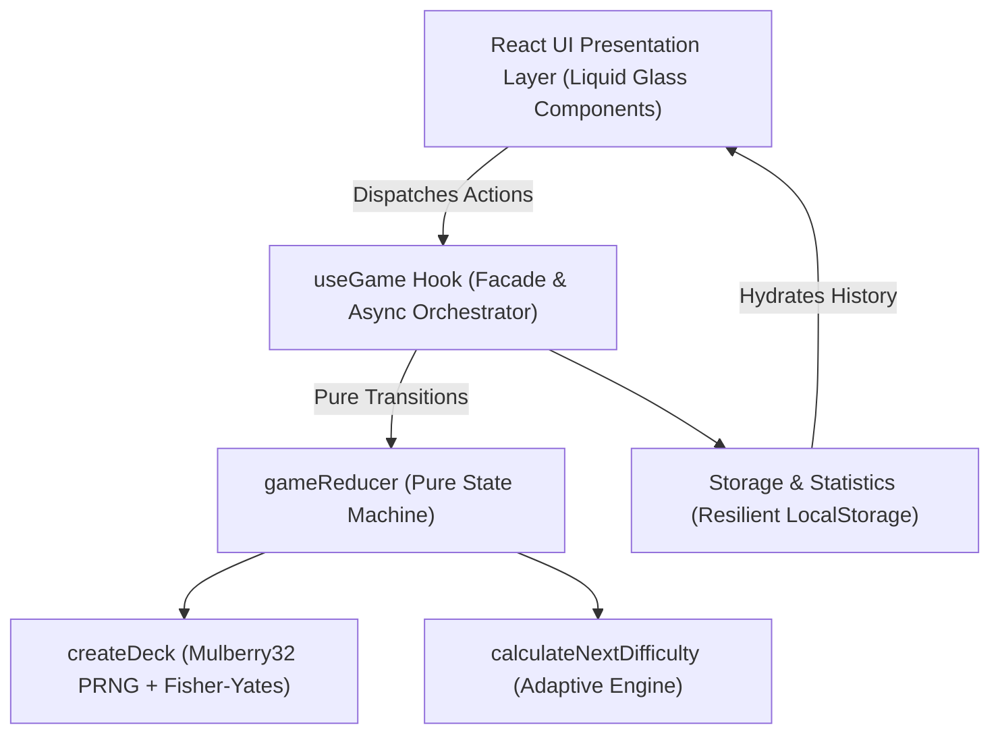
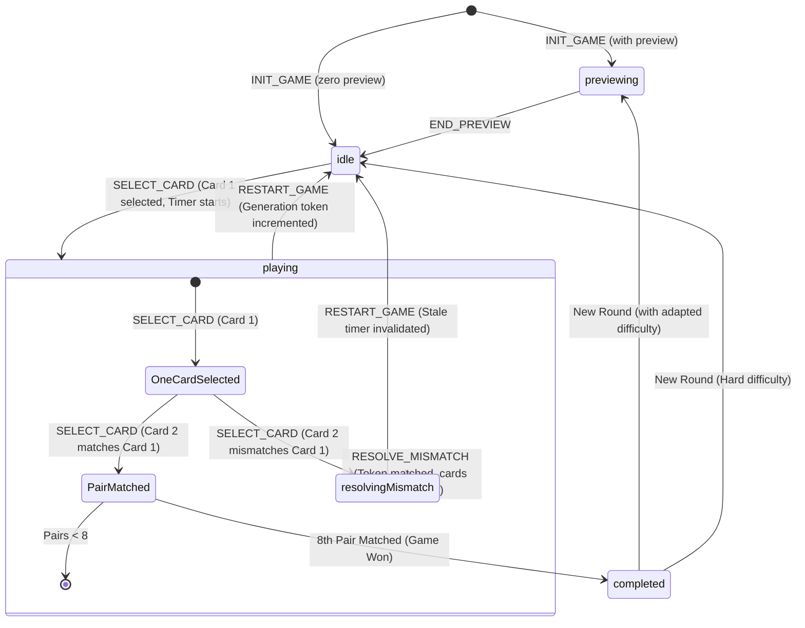
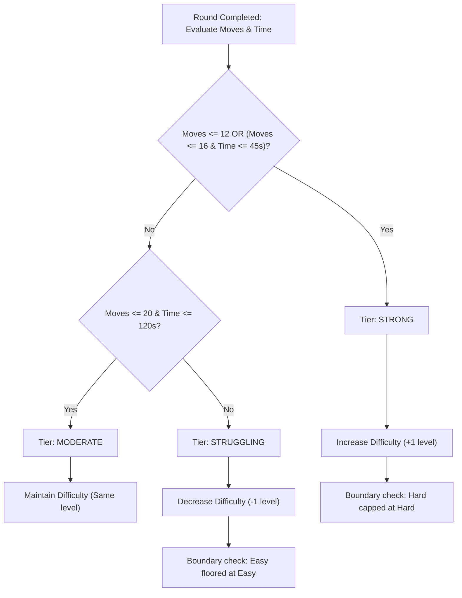

# Adaptive Memory Match — Architectural Specification

**System**: Adaptive Memory Match  
**Problem Statement**: Cerevyn PS09 — Adaptive Memory Matching Game  
**Author**: Hardik (Roll No: 2311981216)  
**Architecture Version**: 1.0.0  

---

## 1. System Overview & Architectural Principles

Adaptive Memory Match is engineered as a deterministic, decoupled single-page application. The core philosophy separates **pure game state calculation** from **declarative UI presentation** and **asynchronous browser event loops**.



---

## 2. Finite State Machine & State Transitions

The core engine implements an explicit finite state machine with 5 discrete phases:
- `idle`: Initial board state waiting for first player interaction.
- `previewing`: Opening memory reveal window (Easy: 2.5s, Medium: 1.2s, Hard: 0s).
- `playing`: Active gameplay loop with timer running.
- `resolvingMismatch`: Temporary interaction lock while two non-matching cards are visible.
- `completed`: All 8 pairs matched; timer stopped; adaptation outcome evaluated.



---

## 3. Seeded Deterministic Deck Generation

To ensure reproducible game fixtures and scientific verification, cards are generated using **Mulberry32**—a 32-bit pseudo-random generator with uniform distribution and a period of \(2^{32}\)—combined with an unbiased **Fisher-Yates shuffle**:

```typescript
export function mulberry32(seed: number): () => number {
  let s = Math.floor(seed) >>> 0;
  return function (): number {
    s = (s + 0x6d2b79f5) >>> 0;
    let t = Math.imul(s ^ (s >>> 15), 1 | s);
    t = (t + Math.imul(t ^ (t >>> 7), 61 | t)) ^ t;
    return ((t ^ (t >>> 14)) >>> 0) / 4294967296;
  };
}
```

### Guarantees
1. **Total Cards**: Exactly 16 cards arranged in a 4×4 grid.
2. **Pairs**: Exactly 8 pairs (Heart, Star, Leaf, Moon, Sun, Diamond, Lightning, Paper Plane).
3. **Uniqueness**: Every card has a distinct identifier (e.g. `heart-1` and `heart-2`) to distinguish identical symbols in the DOM.
4. **Reproducibility**: For any integer seed \(S\), `createDeck(S)` returns the identical sequence across any browser or platform.

---

## 4. Race Condition & Concurrency Safeguards (AC-05, AC-12)

A primary evaluation focus of PS09 is handling edge cases and asynchronous race conditions:

### 1. The Mismatch Interaction Lock
- When a second card is revealed and mismatches the first, the phase transitions to `resolvingMismatch`.
- In `SELECT_CARD`, any subsequent clicks while `phase === 'resolvingMismatch'` are immediately rejected.
- Rapidly spamming cards or clicking a 3rd card produces zero state changes and zero move increments.

### 2. Generation Token Invalidation (`roundGeneration`)
- **Problem**: When a player clicks Restart while a mismatch timeout (e.g. 1200ms) or preview timer is in-flight, the delayed timeout could fire in the middle of the *new* game, flipping cards face down unexpectedly.
- **Solution**: Every restart and new round increments a monotonic integer token: `state.roundGeneration += 1`.
- When the timeout fires:
  ```typescript
  if (currentGenerationRef.current === generationAtSchedule) {
    dispatch({ type: 'RESOLVE_MISMATCH', payload: { generation: generationAtSchedule } });
  }
  ```
  The reducer also verifies `action.payload.generation === state.roundGeneration`. If a stale action arrives, it is discarded safely.

### 3. Repeat & Matched Card Protection
- Clicking an already matched card (`card.isMatched === true`) is a no-op.
- Clicking the currently selected first card again (`firstCardId === cardId`) is a no-op.
- Move count is strictly incremented **only** when a valid second card is selected (1 move = 1 pair attempt).

---

## 5. High-Precision Elapsed Time Loop (AC-06)

Traditional `setInterval(() => seconds++, 1000)` implementations suffer from browser tab throttling, cumulative drift, and background pause inaccuracy.

### Implementation
- Timing begins on the player's first valid interaction (`state.startTime = performance.now()`).
- Time is tracked continuously using `performance.now() - startTime`.
- The animation frame loop updates the display at ~30 FPS, avoiding unnecessary React render thrashing while maintaining sub-millisecond precision.
- On game completion or restart, timing terminates cleanly and exact elapsed milliseconds are persisted.

---

## 6. Adaptive Difficulty Engine (AC-08, AC-10)

Adaptive difficulty balances player cognitive load by dynamically tuning gameplay mechanics between rounds:

### Difficulty Parameters
| Difficulty | Opening Preview Duration | Mismatch Reveal Window | Rationale |
|---|---|---|---|
| **Easy** | 2,500 ms (2.5s) | 1,200 ms (1.2s) | Generous memory retention window for beginners |
| **Medium** | 1,200 ms (1.2s) | 900 ms (0.9s) | Standard cognitive recall test |
| **Hard** | 0 ms (No preview) | 650 ms (0.65s) | Fast-paced challenge requiring active working memory |

### Performance Evaluation Policy


### Explainability
The engine returns both the next difficulty and a deterministic explanation string computed from the player's actual moves and seconds (e.g. `"Outstanding memory! You found all 8 pairs in 10 moves (34s). Difficulty increased from Easy to Medium."`).

---

## 7. Local Persistence & Resilient Data Schema (AC-09)

Session results are persisted anonymously in `localStorage` under `cerevyn_ps09_session_history_v1`.

### Data Schema
```typescript
export interface SessionResult {
  id: string;               // UUID session identifier
  timestamp: number;        // Epoch timestamp
  seed: number;             // Deterministic game seed
  difficulty: Difficulty;   // 'easy' | 'medium' | 'hard'
  moves: number;            // Number of pair attempts
  matchedPairs: number;     // 8
  elapsedMs: number;        // Total active milliseconds
  nextDifficulty: Difficulty; // Adapted difficulty outcome
  adaptationReason: string; // Dynamic explanation
  accuracyPercentage: number; // (8 / moves) * 100
}
```

### Resilience Features
- **Corrupt JSON Handling**: If storage contains invalid syntax, it recovers gracefully to `[]` without throwing exceptions or breaking UI rendering.
- **Malformed Field Filtering**: Validates every record property. If an item lacks required fields or contains unsupported difficulty values, it is safely excluded.
- **Capacity Truncation**: Caps history to the most recent 100 sessions to conserve quota.
- **De-duplication**: Prevents duplicate entries for the same session ID.
