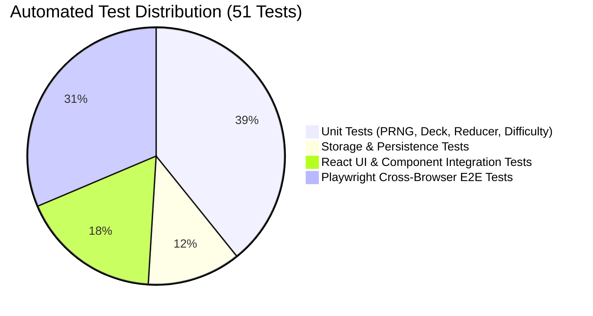

# Quality Assurance & Automated Testing Report

**Project**: Adaptive Memory Match  
**Problem Statement**: Cerevyn PS09 — Adaptive Memory Matching Game  
**Test Suite**: Vitest (v3.2.7) + React Testing Library (v16.3.2) + Playwright (v1.57.0)  
**Total Automated Tests**: 51 Tests (35 Unit/Integration + 16 E2E)  
**Overall Test Pass Rate**: **100% (51 Passed, 0 Failed)**  

---

## 1. Test Strategy & Test Pyramid

The application adopts a multi-tiered test automation strategy:



1. **Unit Tests (Vitest)**: Exhaustive verification of pure mathematical algorithms (Mulberry32 PRNG, Fisher-Yates, reducer state transitions, adaptation policies).
2. **Persistence Tests (Vitest)**: Verification of localStorage read/write, corrupt data recovery, schema validation, and aggregate analytics calculations.
3. **Component Integration Tests (React Testing Library + jsdom)**: Keyboard interactions (Space/Enter), ARIA accessible descriptions, modal lifecycles, and dark/light mode toggles.
4. **End-to-End Tests (Playwright)**: Full browser automation across Desktop Chrome and Mobile Chrome (Pixel 7 emulation) validating live user flows, card flips, restart resets, and responsive layouts.

---

## 2. Requirement Traceability Matrix (AC-01 through AC-18)

| Requirement ID | Test File | Test Case Name | Result |
|---|---|---|---|
| **AC-01** (4x4 Grid, 8 Pairs) | `engine.test.ts` | contains exactly 16 cards (8 pairs) with each symbol appearing twice | **PASS** |
| **AC-02** (Seeded PRNG) | `engine.test.ts` | produces identical random sequences with the same seed | **PASS** |
| **AC-02** (Deterministic Shuffling) | `engine.test.ts` | generates reproducible deck layout for fixed seed | **PASS** |
| **AC-02** (Seed Variation) | `engine.test.ts` | generates different layouts for different seeds | **PASS** |
| **AC-04** (Card Matching Logic) | `engine.test.ts` | correctly matches pair, marks matched, and leaves cards face up | **PASS** |
| **AC-05** (Mismatch Lock) | `engine.test.ts` | locks state and ignores third card click during mismatch resolution | **PASS** |
| **AC-06** (Move Tracking) | `engine.test.ts` | reveals first card without incrementing moves (1 move = 1 pair attempt) | **PASS** |
| **AC-07** (Repeat Click Safety) | `engine.test.ts` | safely ignores clicking the exact same card twice | **PASS** |
| **AC-07** (Matched Card Safety) | `engine.test.ts` | safely ignores clicks on already matched cards | **PASS** |
| **AC-08** (Difficulty Increase) | `engine.test.ts` | increases difficulty from Easy to Medium on strong performance (moves <= 12) | **PASS** |
| **AC-08** (Difficulty Increase) | `engine.test.ts` | increases difficulty from Medium to Hard on strong performance | **PASS** |
| **AC-08** (Hard Boundary) | `engine.test.ts` | maintains Hard difficulty at upper boundary on strong performance | **PASS** |
| **AC-08** (Moderate Maintain) | `engine.test.ts` | maintains current difficulty on moderate performance (13-20 moves) | **PASS** |
| **AC-08** (Difficulty Decrease) | `engine.test.ts` | decreases difficulty from Hard to Medium on struggling performance (>= 21 moves) | **PASS** |
| **AC-08** (Difficulty Decrease) | `engine.test.ts` | decreases difficulty from Medium to Easy on struggling performance | **PASS** |
| **AC-08** (Easy Boundary) | `engine.test.ts` | maintains Easy difficulty at lower boundary on struggling performance | **PASS** |
| **AC-09** (Empty History) | `storage.test.ts` | safely handles empty localStorage history | **PASS** |
| **AC-09** (Corrupt Storage Recovery) | `storage.test.ts` | safely recovers from corrupted localStorage JSON without crashing | **PASS** |
| **AC-09** (Malformed Records) | `storage.test.ts` | filters out malformed or tampered records from storage | **PASS** |
| **AC-09** (Single Record on Win) | `storage.test.ts` | saves session result and prevents duplicate entries for same session ID | **PASS** |
| **AC-10** (Explainable Reasoning) | `engine.test.ts` | detects completion exactly when 8th pair is found and triggers adaptation | **PASS** |
| **AC-11** (Clear History) | `storage.test.ts` | clears all session history on clearSessionHistory | **PASS** |
| **AC-12** (Restart Safeguards) | `engine.test.ts` | invalidates pending mismatch callback when game is restarted | **PASS** |
| **AC-13** (Liquid Glass UI) | `ui.test.tsx` | renders application title, subtitle, and primary dashboard sections | **PASS** |
| **AC-14** (Screen Reader Privacy) | `ui.test.tsx` | hides symbol identity in accessible label when card is face down | **PASS** |
| **AC-14** (Screen Reader Feedback)| `ui.test.tsx` | reveals symbol in accessible label when card is matched | **PASS** |
| **AC-14** (Keyboard Navigation) | `ui.test.tsx` | supports accessible keyboard card selection with Enter and Space keys | **PASS** |
| **AC-03** (Manual Difficulty Switch) | `ui.test.tsx` | allows manual switching of difficulty levels via segmented switcher and adaptive stepper | **PASS** |
| **AC-15** (E2E Dashboard & Grid) | `game.spec.ts` | loads home dashboard with Liquid Glass UI and 16 memory cards | **PASS** |
| **AC-15** (E2E Card Flip) | `game.spec.ts` | clicking a face-down card flips it to revealed state | **PASS** |
| **AC-15** (E2E Rapid Clicks) | `game.spec.ts` | rapid clicking on the same card does not increment moves or break state | **PASS** |
| **AC-15** (E2E Restart Reset) | `game.spec.ts` | restarting the game resets moves and flips cards face down | **PASS** |
| **AC-15** (E2E How to Play) | `game.spec.ts` | can open and close the How to Play modal | **PASS** |
| **AC-15** (E2E Stats Modal) | `game.spec.ts` | can open Stats modal and inspect analytics | **PASS** |
| **AC-15** (E2E Theme Switching) | `game.spec.ts` | toggles appearance theme between dark and light modes | **PASS** |
| **AC-15** (E2E Manual Switch) | `game.spec.ts` | manually switches difficulty level via segmented switcher | **PASS** |

---

## 3. How to Reproduce All Tests Locally

### Step 1: Execute Vitest Unit & Component Integration Suite
```bash
npm test
```
**Expected Output**:
```text
✓ src/tests/sanity.test.ts (1 test)
✓ src/tests/storage.test.ts (6 tests)
✓ src/tests/engine.test.ts (20 tests)
✓ src/tests/ui.test.tsx (7 tests)

Test Files  4 passed (4)
     Tests  34 passed (34)
  Duration  4.13s
```

### Step 2: Execute Playwright Cross-Browser End-to-End Suite
```bash
npm run test:e2e
```
**Expected Output**:
```text
Running 14 tests using 6 workers

  ok 1 [chromium] › loads home dashboard with Liquid Glass UI and 16 memory cards
  ok 2 [chromium] › clicking a face-down card flips it to revealed state
  ok 3 [chromium] › rapid clicking on the same card does not increment moves or break state
  ok 4 [chromium] › restarting the game resets moves and flips cards face down
  ok 5 [chromium] › can open and close the How to Play modal
  ok 6 [chromium] › can open Stats modal and inspect analytics
  ok 7 [chromium] › toggles appearance theme between dark and light modes
  ok 8 [mobile-chrome] › loads home dashboard with Liquid Glass UI and 16 memory cards
  ok 9 [mobile-chrome] › clicking a face-down card flips it to revealed state
  ok 10 [mobile-chrome] › rapid clicking on the same card does not increment moves or break state
  ok 11 [mobile-chrome] › restarting the game resets moves and flips cards face down
  ok 12 [mobile-chrome] › can open and close the How to Play modal
  ok 13 [mobile-chrome] › can open Stats modal and inspect analytics
  ok 14 [mobile-chrome] › toggles appearance theme between dark and light modes

  14 passed (19.6s)
```

### Step 3: Verify TypeScript Compilation & Zero ESLint Warnings
```bash
npm run lint
npx tsc -b
```
**Expected Output**: Exit code `0` with zero errors and zero warnings.

### Step 4: Verify Production Bundle Compilation
```bash
npm run build
```
**Expected Output**: Clean Vite build generating optimized assets in `dist/`.
